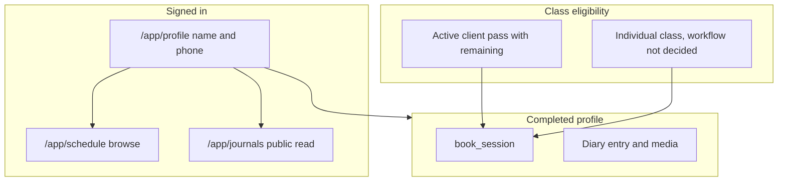

# Pole Progress roadmap

One deployment is one studio and one Supabase project. There is no `studio_id`.

The training diary remains in the product. The current implementation priority is profile completion, the client schedule and bookings, pass balances, and a simple admin area for sessions, pass products, and client passes. A completed profile is not an active pass and is not proof that the client has paid.

Pole Progress does not process payments. Clients pay for passes and for individual classes outside the application. No online payment gateway, checkout, payment processing, or payment-provider integration is in the current scope, and none of that is a dependency for the schedule or for booking. The app may track pass balances. Only if a later approved workflow explicitly requires it may an administrator manually record that an external payment was confirmed. That record is administrative bookkeeping. It must not mean the application processed or verified a financial transaction. Booking status stays separate from any such record. Pass type, client pass, validity, remaining class credits, and the booking stay separate records. The booking and bookkeeping workflow for a client without a pass is undecided and is not a committed milestone.

Status values: **DONE** (frontend, data access, and database authorization are present), **PARTIAL** (some of those layers exist), **PLANNED** (not built), **NEEDS VERIFICATION** (the repo cannot prove runtime or remote state). Do not treat a route, component, or migration as verified behavior.

The identifiers below are kept from the previous plan. Several items that were optional studio work are now in scope. Their old "optional" names stay so history is readable.

| Id | Previous plan | Current status |
| --- | --- | --- |
| `s1-roles` | completed | **DONE:** roles are `admin` and `student` only. `20261012201704_remove_instructor_role.sql` removes the instructor role, `is_staff()`, and `is_instructor()`. Admin checks use `is_admin()`. `class_sessions.instructor_id` is the class teacher, not a role |
| `s2-schema` | completed | **DONE** for the pass-only model: `class_types`, `class_sessions`, `bookings`, `pass_products`, `client_passes`. **DONE in repo:** nullable `profiles.phone` in `20261013110806_profile_phone.sql`; existing rows stay null. Hosted apply is **NEEDS VERIFICATION**. A booking without a pass is not scheduled; `bookings.pass_id` is still `not null` |
| `s3-calendar` | completed | **DONE in the repository for browsing:** `/app/schedule` filters the loaded week by class type, instructor, and Kyiv start time, and each card shows the date, start time, class type, instructor, capacity, active bookings, and remaining seats. Remaining seats are `capacity - booked_count`, and `booked_count` counts only `status = 'booked'`. Available, full, and cancelled stay distinct. Seeing the schedule does not open booking. Any signed-in user can browse, including an incomplete profile and a client without a pass. Checked in the local browser, including an incomplete profile and a temporarily revoked pass. Hosted apply and a hosted browser pass are **NEEDS VERIFICATION** |
| `booking-optional` | completed | **PARTIAL, NEEDS VERIFICATION:** `book_session` / `cancel_booking` spend and sometimes restore a pass credit, and the schedule shows capacity. Booking still requires an active pass with `remaining > 0`. A client `INSERT` on `bookings` can skip the RPC. There is no booking path for a client without a pass. The app does not process payments |
| `s4-diary-stages` | completed | **DONE:** attempt stages, chronological media timeline, diary routes |
| `s5-diary-home` | pending | **PARTIAL, deferred:** stage counts, stage pills, search, and with/without-records filter exist. A recent-attempts list, a stage filter, and a first-attempt prompt on `/app` are not the next work |
| `s6-instructor-diary` | completed | **DONE:** `/app/students` is admin-only. Instructor notes are removed. Comments stay on `attempt_comments` |
| `public-journals` | completed | **DONE in repo** for any signed-in user while `journal_public` is true, including an incomplete profile and a client without a pass. Likes and comments still need a completed profile and studio access. Private journals stay with the owner and admin. Local SQL checked a public read, a private hide, and a blocked like. A browser pass with two accounts is **NEEDS VERIFICATION**. Hosted apply is **NEEDS VERIFICATION** |
| `admin-clients` | completed | **PARTIAL:** `/admin/clients` lists clients, changes roles, and issues or renews one active pass. It does not show profile completion, phone, bookings, or attendance, and it does not edit pass products |
| `s7-passes-optional` | pending | **PARTIAL:** `PassesApi.listMine` and balances on `/app/schedule`. Passes are not on `/app/profile`. No pass-product editor |
| `s8-classes-optional` | pending | **PLANNED, now in scope:** admin writes for class types and sessions exist in RLS. Angular has no screen for them |

## Product focus

Keep these checks separate:

| Check | What it means today | What it must mean |
| --- | --- | --- |
| Signed in | Supabase session | Required for the app |
| Profile complete | `profiles.phone` is nullable. `/app/profile` edits name and phone. `profile_is_complete()` is true only when both are non-empty after trimming whitespace. `book_session`, the caller's `cancel_booking`, attempt and media writes, likes, and comments require it. `has_studio_access()` does not. An admin cancel does not | Non-empty visible name and a phone number. Required before booking, diary writes, diary media, and other write actions called out below |
| Studio access | `has_studio_access()`: admin, or a `client_passes` row with `status = 'active'` and `now` inside `valid_from` / `valid_until`. Spending the last credit sets `exhausted`, which removes access | Still not the same as a completed profile. A pass with remaining credits is one way to attend. Attending one class without a pass is a separate path and is not designed yet. Do not treat a completed profile as either one. Neither path means the app took a payment |
| External payment | Not recorded. Clients pay outside the app. `book_session` raises `no_pass` when there is no eligible pass | Stays outside the app. No gateway, checkout, or provider. A manual admin note that an external payment was confirmed is allowed only after that workflow is explicitly approved, and it is bookkeeping only |

A signed-in user with an incomplete profile must be able to view the schedule, view public journals, and open `/app/profile`. They must not book a class, create a diary entry, upload diary media, or perform the other restricted actions in milestone 2. The app redirects those attempts to `/app/profile`, explains what is missing, and keeps the original path when it can. RLS and RPCs enforce the same restriction. Hidden buttons are not enough.

`DropIn` is not built. Milestone 8 stays blocked until the decisions in the next section are approved. It is not a commitment to add bookkeeping or a payment step.

## Unresolved business decisions

Decisions 1, 2, and 4 block milestone 8. Decisions 3 and 5 block changes to the current pass-cancellation and eligibility behavior. The roadmap does not choose them, and it does not define a payment workflow while they are open. Schedule, pass booking, and milestones 1–7 do not wait on a payment provider.

1. **Booking without a pass.** May a client with no eligible pass reserve a seat, and does that depend on an administrator first recording that payment was made outside the app? Undecided. Do not invent the sequence.
2. **Manual record of an external payment.** Whether the app should store an administrator’s note that a pass or an individual class was paid for outside the app is undecided. If that workflow is approved later, the note is bookkeeping only, and it stays separate from booking status, the pass product, the client pass, validity, and remaining credits. This roadmap does not choose a column, a table, or status names. The app still must not process or verify the payment.
3. **Cancellation cutoff and pass-credit restore.** The database already has a default, not a confirmed product rule. `app_settings.cancel_cutoff_hours` defaults to 12. `cancel_booking` always sets the booking to `cancelled`. It adds the class credit back only when the session is already `cancelled`, or when `starts_at` is still more than that many hours away. A late cancel keeps the credit spent. Revoked or expired passes are not refilled. This is a class credit, not a money refund. Whether this stays the rule is undecided.
4. **Capacity after cancel.** Today a `cancelled` booking is omitted from `booked_count` immediately, so the seat is free as soon as cancel succeeds. Whether that remains true, including for a booking by a client without a pass once that path exists, is undecided.
5. **Pass validity and which classes a pass covers.** `pass_products` stores `class_count` and `validity_days` only. It does not point at class types. Issuing a pass copies `class_count` into `client_passes.remaining` and stores the dates the admin picked. `book_session` then accepts any scheduled future session while that pass is `active`, in date, and `remaining > 0`. It spends the pass that expires soonest. Whether every pass fits every class, and whether dates must follow `validity_days`, is undecided.

Until those are decided, keep the current pass-only booking behavior. Do not add a second booking path, a payment status, or a bookkeeping field that guesses the answers.

## Current product features

### Auth — DONE in the repository

- Routes: `/sign-in`, `/forgot-password`, `/auth/callback`, `/access-pending`, `/forbidden`, and `/app/profile` in [`libs/core/auth/src/lib/auth.routes.ts`](../libs/core/auth/src/lib/auth.routes.ts), [`libs/features/shell/src/lib/shell.routes.ts`](../libs/features/shell/src/lib/shell.routes.ts), and [`apps/app/src/app/app.routes.ts`](../apps/app/src/app/app.routes.ts).
- Email and password, plus Google OAuth, in [`libs/core/auth`](../libs/core/auth). Magic link is rejected in [`libs/core/auth/src/lib/email-otp.ts`](../libs/core/auth/src/lib/email-otp.ts). The sign-in page offers Google only. Instagram is not a provider in the UI. Password recovery is `/forgot-password`, then `/auth/callback?token_hash&type=recovery`.
- Roles: `student` (UI: Клієнт) and `admin`. A client cannot change `profiles.role`. An admin can, including from `/admin/clients`.
- `/app/profile`, `/app/schedule`, and `/app/journals` are behind the shell `authOnlyGuard` only. Diary home and `/app/elements` use `profileCompletionGuard`: an incomplete profile goes to `/app/profile` with `notice=incomplete` and a `redirect` back to the diary path; a complete profile without a pass still goes to `/access-pending`. Admins are not sent to the profile page for an incomplete profile. Students and `/admin` stay on `studioAccessGuard` and `adminOnlyGuard`.
- Tests: [`libs/core/auth/src/lib/studio-access.spec.ts`](../libs/core/auth/src/lib/studio-access.spec.ts), [`libs/core/auth/src/lib/profile-gate.spec.ts`](../libs/core/auth/src/lib/profile-gate.spec.ts). Playwright covers only the unauthenticated redirect to `/sign-in`.

Hosted Google, the recovery template, and password setup on a Google-only user are **NEEDS VERIFICATION**.

### Profile — DONE in the repository and on the local database

[`libs/core/auth/src/lib/pages/profile.page.ts`](../libs/core/auth/src/lib/pages/profile.page.ts) edits `profiles.name` and `profiles.phone`, shows the session email, and shows whether the profile is complete. An empty or whitespace-only name or phone is rejected in Ukrainian. Password set/change and the link to password recovery are unchanged. When the profile is incomplete or there is no studio access, one card replaces the old stack of warnings. Its title is the blocked-action sentence only after a redirect (`notice=incomplete`). The card says the schedule and other people's public journals are available now, that a saved name and phone let the studio recognize the client and do not grant a pass, and that an абонемент issued by the studio opens the client's own diary and booking. [`/access-pending`](../libs/core/auth/src/lib/pages/access-pending.page.ts) uses the same split. Copy lives in [`access-benefit.ts`](../libs/core/auth/src/lib/access-benefit.ts). The screen was not opened in a browser after this copy change.

[`20261013110806_profile_phone.sql`](../supabase/migrations/20261013110806_profile_phone.sql) adds nullable `profiles.phone` and does not fill existing rows. `public.profile_is_complete()` reads the signed-in row and takes no user id. `public.own_profile_phone()` returns that same row's phone. `authenticated` may select `id`, `name`, `role`, `created_at`, and `journal_public` only. The owner updates name and phone on their own row. `profiles_update_admin_or_own` still rejects a client role change and an update of another profile. An admin still changes roles from `/admin/clients`. An admin cannot select `phone` through the table; the client-directory read is milestone 9.

Tests: [`profile-completion.spec.ts`](../libs/core/auth/src/lib/profile-completion.spec.ts), [`access-benefit.spec.ts`](../libs/core/auth/src/lib/access-benefit.spec.ts), and the public-journal column list in [`journal.spec.ts`](../libs/core/data/src/lib/journal.spec.ts). On the local database, a rolled-back check and a PostgREST round trip confirmed completion, the role rejection, and that another client receives `42501` for `select=phone` while a public-journal name select still works. The demo phone was set back to null. The hosted migration is not applied. The profile screen was not opened in a browser.

### Catalog, branding, and the owner's diary — DONE

- Admin: `/admin/categories`, `/admin/elements`, `/admin/branding` behind `adminOnlyGuard`. Catalog images use the public `catalog` bucket.
- Diary home: [`libs/features/dashboard`](../libs/features/dashboard). Stage counts, a stage pill on cards that have attempts, search, category filter, and **Усі / З записами / Без записів**.
- Element timeline: [`libs/features/element`](../libs/features/element). Stages `trying | in_progress | mastered`. Chronological timeline. Owner create, edit, and delete. Private `media` bucket; rows store paths and the app mints signed URLs.
- `held` was removed in [`supabase/migrations/20261012210351_remove_held_stage.sql`](../supabase/migrations/20261012210351_remove_held_stage.sql).
- Writes require `has_studio_access()` and `profile_is_complete()` in RLS ([`supabase/migrations/202610080006_studio_access.sql`](../supabase/migrations/202610080006_studio_access.sql), gates in [`supabase/migrations/20261013114234_profile_completion_gates.sql`](../supabase/migrations/20261013114234_profile_completion_gates.sql)). A finished profile without a pass still cannot log attempts. Own diary **select** for a pass holder does not require a completed profile; the route guard is what keeps an incomplete profile off the diary screens.
- Tests: [`libs/core/data/src/lib/attempt-stage.spec.ts`](../libs/core/data/src/lib/attempt-stage.spec.ts), [`libs/features/element/src/lib/timeline.spec.ts`](../libs/features/element/src/lib/timeline.spec.ts).

Diary-home extras stay **PARTIAL** and are deferred. See [Deferred](#deferred).

### Admin diary review — DONE

- `/app/students` is behind `adminOnlyGuard` ([`libs/features/students`](../libs/features/students)). Comments use `attempt_comments`.
- [`supabase/migrations/202610080005_staff_read_student_diary.sql`](../supabase/migrations/202610080005_staff_read_student_diary.sql) added staff read of attempts and media. `20261012201704` limits those policies to `is_admin()`.

### Public journals — DONE in the repository for any signed-in user

- Default is private. The owner turns on **Публічний щоденник** on `/app`.
- Any signed-in user opens `/app/journals`, including an incomplete profile and a client without a pass. Turning the journal private hides attempts and media again. An admin still reads every diary at `/app/students`.
- Likes and comments: `attempt_likes`, `attempt_comments`. Comment text is trimmed and limited to 2000 characters. Those writes need `profile_is_complete()` and `has_studio_access()`.
- Security: [`supabase/migrations/202610090002_public_journals.sql`](../supabase/migrations/202610090002_public_journals.sql), with the pass requirement removed from the public **select** policies in [`supabase/migrations/20261013114234_profile_completion_gates.sql`](../supabase/migrations/20261013114234_profile_completion_gates.sql). Helpers live in schema `private`. Phone is still absent from the peer column list.
- Local SQL, rolled back: a client with no pass read a public attempt and its storage object, and did not see a private attempt or a private storage object. A like insert failed until the profile was complete and the pass was active. A browser pass with two accounts is **NEEDS VERIFICATION**.

### Admin clients — PARTIAL

- `/admin/clients` ([`libs/features/admin/src/lib/pages/clients.page.ts`](../libs/features/admin/src/lib/pages/clients.page.ts)): name, email, id, role, and whether one pass is active now. **Видати** inserts an active `client_passes` row. **Продовжити** updates that active row and refills `remaining` from the chosen product. The signed-in admin cannot change their own role in the UI.
- Emails come from `admin_profile_emails()` in [`supabase/migrations/202610090001_admin_clients.sql`](../supabase/migrations/202610090001_admin_clients.sql). Insert and update on `client_passes` require `is_admin()`.
- Pass products are read-only here. The page says when the catalog is empty.
- There is no class-session screen, no product editor, no profile-completion column, and no booking or attendance history. Phone is not on this screen; `authenticated` cannot select `profiles.phone`.
- Tests: [`client-directory.spec.ts`](../libs/features/admin/src/lib/client-directory.spec.ts), [`pass-dates.spec.ts`](../libs/features/admin/src/lib/pass-dates.spec.ts). Issuing a pass on a live database is **NEEDS VERIFICATION**.

### Schedule, booking, and passes — PARTIAL

What exists:

- `/app/schedule`: week list, class-type, instructor, and start-time filters, book and cancel, and a card with the date, start time, class type, instructor, capacity, active bookings, and remaining seats. Available, full, and cancelled are separate labels. Hints still cover a past class, a missing pass, and an incomplete profile. Pass balances sit on this page. The copy says free seats do not open booking. [`libs/features/schedule`](../libs/features/schedule), [`ScheduleApi`](../libs/core/data/src/lib/schedule.api.ts), [`BookingsApi`](../libs/core/data/src/lib/bookings.api.ts).
- `list_sessions_in_range` filters by time range and optional `type_id` only. The page loads the whole week and filters class type, instructor, and start time in the schedule feature. The RPC returns `instructor_id`, `instructor_name`, `capacity`, `booked_count`, and `status`. `booked_count` is `count(*)` of `bookings` for that session with `status = 'booked'`. Remaining seats are `max(0, capacity - booked_count)`. The function does not return booking user ids, pass ids, emails, or phone numbers. It requires a signed-in user and does not require a pass or a completed profile. `class_sessions` table select still requires studio access; the page uses the RPC. Class types, the shared element catalog, and `app_settings` select are open to any signed-in user so the schedule filter, the cutoff, and a public journal page can render.
- `book_session` locks the session row, rejects a second `booked` row for the same user and session, counts `status = 'booked'`, and rejects the insert when that count is at capacity. A partial unique index matches that pair. The pass row is locked, then `remaining` drops by one. At zero the pass becomes `exhausted`.
- `cancel_booking` uses the cutoff described in decision 3. The owner or an admin may cancel. The owner's cancel also requires `profile_is_complete()`. An admin cancel does not. The function still requires `has_studio_access()`. After the last credit, the pass is `exhausted`, so the client loses studio access and the RPC rejects their cancel. That lockout is unintended relative to "a client can cancel their own booking".
- `BookingsApi.listMine()` reads the caller's rows. The profile page does not. The schedule uses the list only to mark the visible week.
- Schema and admin write policies: [`supabase/migrations/202610080001_schedule_bookings_passes.sql`](../supabase/migrations/202610080001_schedule_bookings_passes.sql), with `is_staff()` replaced by `is_admin()` in `20261012201704`. RPCs: [`supabase/migrations/202610080002_booking_rpcs.sql`](../supabase/migrations/202610080002_booking_rpcs.sql), studio-access checks in `202610080006`, `cancel_booking` redefined again in `20261012201704`.
- The migration inserts demo class types, one week of sessions, one pass product, and two demo auth users. `20261012201704` sets the demo teacher's role to `student` and keeps the profile because sessions reference it. The statements are not wrapped in an environment check.
- Tests: [`week.spec.ts`](../libs/features/schedule/src/lib/week.spec.ts), [`schedule-view.spec.ts`](../libs/features/schedule/src/lib/schedule-view.spec.ts), and [`booking-access.spec.ts`](../libs/features/schedule/src/lib/booking-access.spec.ts). They cover Kyiv week and start time, combined filters, an empty week, a filter with no matches, a full class, a cancelled class, and remaining seats that ignore cancelled bookings. Booking, capacity under concurrent calls, and credit changes are **NEEDS VERIFICATION**. A local browser pass of the filters is recorded under [Needs verification](#needs-verification). Hosted is still open.

Gaps that matter before any booking for a client without a pass:

- `bookings_insert_staff_or_own` still lets a client insert their own `booked` row. The policy checks an active pass with `remaining > 0` and a scheduled session. It does not lock the session, check capacity, or decrement `remaining`. Calls that skip `book_session` can overbook and spend the same credit twice.
- `bookings.pass_id` is `not null`, so a class without a pass cannot be stored yet. Do not change that until decisions 1 and 2 are approved.
- There is no payment table, and none should be added for processing payments. There is no attendance table. Past bookings are the only attendance history.
- No admin UI to create or cancel a session. Session rows are SQL or Studio today.

## Milestones

Each milestone is one implementation task. Apply a new migration file when the database changes. Leave applied migrations untouched. Ship the migration before a frontend that depends on the new column or RPC. Angular guards are extra. RLS and RPCs are the boundary.

### 1. Profile completion on `/app/profile` — DONE in the repository and on the local database

Hosted apply and a browser pass of `/app/profile` are **NEEDS VERIFICATION**. Do not change schedule, journal, diary, or booking access in a follow-up that is still this milestone; that widening is milestone 2.

Database, new migration:

- Add nullable `profiles.phone`. Do not invent numbers for existing rows.
- Completion is a non-empty name and phone after trimming leading and trailing whitespace. Null and whitespace-only values are incomplete. `public.profile_is_complete()` is that check; it reads the signed-in user's row and does not accept a client-supplied user id.
- Peers must not read `phone`. A public-journal profile select can see `name` today. Revoke phone from that path (column privileges or an equivalent that PostgREST cannot bypass). The owner reads their phone. An admin reads it for the client directory later.

App:

- `/app/profile` edits name and phone, rejects an empty name, shows the email, and shows whether the profile is complete.
- Keep password set/change and the link to password recovery as they are.
- Ukrainian copy. Do not claim that a complete profile activates a pass.

Acceptance:

- A new Google or email user with an empty name or no phone is incomplete, including when Google filled `name` and phone is still empty.
- Saving a non-empty name and phone flips the profile to complete and survives reload.
- Another signed-in client cannot select that phone, including through a public journal profile.
- Booking, diary writes, and `has_studio_access()` behave as they do today.
- Unit tests cover the completion predicate, a role field on the client payload, and the public-journal column list. Local SQL and PostgREST checks passed and were rolled back or restored. Repeat save, reload, and a second-user phone read on the hosted project after `db push`.

### 2. Browse without a completed profile; block restricted actions — DONE in the repository and on the local database

Hosted apply and a browser pass are **NEEDS VERIFICATION**. Depends on milestone 1. This widens schedule and public-journal **reads** from "admin or active pass" to "any signed-in user". Private journals stay owner and admin only.

Local SQL in one rolled-back transaction: an incomplete client with a pass could list sessions and a public journal, and `book_session`, a direct booking insert, an attempt insert, and a like insert failed. After the pass was revoked, schedule and public-journal reads still worked and a private attempt stayed hidden. Completing the profile did not make `has_studio_access()` true, and `book_session` then returned `no_pass`. Restoring the pass allowed `book_session`, an attempt insert, a media-row insert, a storage upload, and a like. An incomplete admin could `cancel_booking` that row. `anon` could not call `list_sessions_in_range`. The demo phone and pass were unchanged after rollback.

Allowed while the profile is incomplete:

- View `/app/schedule`, including capacity, active booking count, and remaining seats.
- View public journals (read only).
- Open `/app/profile`.

Redirect to `/app/profile` with a short explanation, and keep a safe internal return path, when an incomplete profile tries to:

- Book or cancel a class.
- Open the diary home or an element in a way that leads to creating an entry. Reading is included until the profile is complete, because the allow-list is only schedule, public journals, and profile.
- Create or edit an attempt, upload or delete diary media.
- Like or comment on a journal.

Backend, same migration window as the UI:

- `list_sessions_in_range` and `get_session_card` require a signed-in user and do not require `has_studio_access()` or `profile_is_complete()`.
- Public-journal **select** policies for profiles, attempts, media rows, and public-journal storage objects allow any signed-in user while `journal_public` is true. They still hide a private journal. Do not add phone to the peer-visible columns.
- `book_session`, attempt insert/update/delete, media-row writes, media-object writes, likes, and comments require `profile_is_complete()` in addition to the existing ownership and studio-access checks.
- `cancel_booking` of the caller's own row also requires a complete profile. Do not use that requirement to block an admin.
- The shell shows **Розклад** and **Щоденники** to every signed-in client. Diary, students, and admin stay behind their current guards. Book and cancel controls stay off until the profile is complete; the RPC is the real gate.

`has_studio_access()` stays "admin or active pass". Do not redefine it as profile completion. Diary writes still need studio access after the profile is complete, so a finished profile without a pass cannot log attempts.

Acceptance:

- Incomplete profile, with and without a pass: schedule and a public journal open; book, diary create, and media upload redirect to `/app/profile` and fail in the database if called directly; the return path comes back after save.
- A private journal stays hidden from that user.
- A complete profile with no pass can browse and still cannot book (`no_pass`) or write a diary.
- A complete profile with an active pass can book, as today.
- Regression: owner and admin still read a private diary; a peer loses access when the owner turns the journal off.

### 3. Schedule filters and seat copy — DONE in the repository and checked on the local app

Hosted apply and a hosted browser pass are **NEEDS VERIFICATION**. Depends on milestone 2 for who can open the page. No new migration: one studio week already includes instructor, start time, capacity, and `booked_count`, so the schedule feature filters it. The RPC was not given new arguments.

- Filter the visible week by class type, instructor, and Kyiv start time. The week pager still reloads the range.
- Show the date, start time, class type, instructor, capacity, the number of active bookings, and remaining seats. A full class and a `cancelled` session stay visibly distinct from a scheduled class that still has seats.
- The schedule stays open to any signed-in user. A missing pass or an incomplete profile hides the book button and does not hide the session.
- Keep booking on `book_session`. Do not calculate a pass spend in Angular. Do not list other clients on the card.

Acceptance: filters combine with the class-type control and the week pager; a full or cancelled class cannot be booked from the UI; the RPC still returns `class_full` or `session_unavailable` if the UI is bypassed. `book_session` was not called in this task. A direct client insert can still create a row past capacity until milestone 4. The displayed remaining count follows the `booked` rows that exist and is zero when that count is at or above capacity. Local evidence is in [Needs verification](#needs-verification).

### 4. Pass-booking integrity

No new payment rule. Preserve the current cutoff, the current credit restore, and immediate capacity release until the decisions above change them.

New migration:

- Remove the client path in `bookings_insert_staff_or_own`. Clients book only through `book_session`. Admins do not insert bookings from the client policy either; keep admin cancel on the RPC.
- `cancel_booking`: the owner can cancel their own `booked` row even when spending the last credit has set the pass to `exhausted` and `has_studio_access()` is false. Still require a complete profile after milestone 2. Keep the existing restore condition.
- Leave `pass_id` required.

Acceptance, on a database, two sessions if needed:

- Two concurrent `book_session` calls cannot exceed capacity or create two active rows for one user and session.
- A direct insert from the client role fails.
- One pass credit cannot cover two bookings.
- Cancelling the booking that exhausted the pass succeeds for that client. Before the cutoff the credit returns and the pass can become `active` again. After the cutoff the seat is free and the credit stays spent.
- A client cannot cancel someone else's booking.

### 5. Bookings and passes on `/app/profile`

Depends on milestones 1 and 4. The page stays a profile, not a second schedule or diary.

- Upcoming and past bookings for this user, with class time, instructor, and status. Use a read that the owner can execute without studio access, so a client who exhausted a pass still sees history.
- The client's passes and remaining balances, including a pass that is not currently spendable, with status and dates. Keep the "spent next" hint if more than one pass is active; the schedule already sorts by `valid_until`.
- Do not duplicate the week browser or the journal editor.

Acceptance: after a book and a cancel, the profile lists match the schedule. A client cannot read another client's bookings or passes.

### 6. Admin class sessions

Does not wait on a payment provider or on the undecided individual-class workflow. Reuse `class_types`, `class_sessions`, and the admin write policies. A simple list and form is enough. Do not build a calendar editor. Do not add payment processing.

- Create and edit a session: date, start, end, instructor (`profiles.id`), capacity, and class type.
- Cancel a session (`status = 'cancelled'`). Do not delete history by default.
- The client schedule shows the change after refresh.
- Instructor choices are profiles, not a separate role. The existing demo teacher is a `student` profile used only as `instructor_id`.

Acceptance: a non-admin insert or update fails in Postgres. Cancelling a session marks it cancelled on `/app/schedule`. This task does not define whether existing bookings are auto-cancelled or have a class credit restored; that stays with decisions 3 and 4. Until then, cancelling a session does not silently rewrite bookings.

### 7. Admin pass products

Does not wait on a payment provider or on the undecided individual-class workflow. `pass_products` already has admin insert, update, and delete policies and no editor. Issuing a pass records the product, dates, and credits. It does not record or verify a payment.

- Create and edit a product: name, class count, validity days, active flag.
- `/admin/clients` already issues from this catalog. Deactivating a product hides it from new issues and does not delete passes already issued.
- Do not add class-type eligibility until decision 5.

Acceptance: an empty catalog can be filled from the admin UI, and a client still cannot insert a product or a pass.

### 8. Individual-class booking — blocked, not a committed design

Do not start until decisions 1, 2, and 4 are approved. Decision 3 matters only if that future path can be cancelled. This milestone is a placeholder so the question is not forgotten. It is not permission to add a payment workflow, a payment status, or a payment provider.

Until an approved decision says otherwise:

- Keep the pass-only booking path.
- Leave `pass_id` required.
- Do not add a column or table for payment confirmation.
- Pass product, client pass, validity, remaining credits, and booking status stay separate. Any later bookkeeping status an admin sets by hand also stays separate from booking status, and it only records that payment happened outside the app.

A pass booking, once the client is allowed to book, still spends one `client_passes.remaining` inside `book_session`. A class without a pass must not change pass balances. Profile completion from milestone 2 still applies to booking. Capacity rules from milestone 4 stay in force for pass bookings.

### 9. Admin client history

Can show profile completion and pass-based bookings after milestones 1 and 5. Individual-class rows wait for milestone 8. Do not invent a check-in table. Attendance history is booking history until a later product decision says otherwise.

- On `/admin/clients`, or a client detail reached from it: completion (name and phone present), phone visible to the admin only, passes, and bookings with session time and status. Read the phone through a security-definer admin function. `authenticated` has no `SELECT` on `profiles.phone`, so a table select cannot expose it.
- Reuse the directory, role change, and issue/renew actions. Do not add a second client list.

Acceptance: a non-admin cannot read the directory, phones, or other people's bookings. Completion on this screen matches `/app/profile`.

## Security and regression checks

Run these when the milestone that touches them is implemented. The repo has no RLS integration suite, so the database checks are manual or a future SQL test.

| Area | Check |
| --- | --- |
| Profile completion | Incomplete user cannot `book_session`, insert an attempt, or upload to `media`, with or without a pass. Completing the profile does not make `has_studio_access()` true. Checked locally and rolled back. Hosted apply is **NEEDS VERIFICATION** |
| Phone | Owner reads it through `own_profile_phone()`. A peer, including one reading a public journal, cannot select the column. Admin table select does not include it until milestone 9. Checked locally; hosted apply is **NEEDS VERIFICATION** |
| Public and private journals | Public read is any signed-in user. Private attempts, media, likes, and comments stay with the owner and admin. Turning `journal_public` off hides the peer read again. Local SQL checked one public and one private attempt. A browser pass is **NEEDS VERIFICATION** |
| Booking capacity | Concurrent `book_session` stops at capacity. The partial unique index still blocks a second active row. Direct client insert fails after milestone 4 |
| Pass balance | `remaining` never goes below zero. One credit cannot attach to two `booked` rows. Cancel restores a credit only under the current cutoff, or under a later decided rule. A client cannot update `client_passes` |
| Roles | A client cannot set `profiles.role`. Admin routes stay admin-only in the database, not only in the router |
| Individual class | Until an approved decision replaces it, `no_pass` still rejects a booking. A later path for a client without a pass must not decrement a pass and must not treat a bookkeeping flag as proof the app took money |

Also re-check the existing diary after milestone 2: owner timeline, admin `/app/students`, and signed media URLs.

## Deferred

- Diary home extras: recent attempts across elements, a stage filter, and a first-attempt prompt on `/app`. The element page already explains an empty element.
- Waitlist.
- Payment processing: online payment gateways, checkout, and payment-provider integrations. A manual admin note that an external payment was confirmed is not part of this list, and it is also not scheduled. It waits on decisions 1 and 2.
- A visual calendar builder for sessions.
- Multi-studio and `studio_id`.
- Magic link, Instagram sign-in, extra auth providers, account merging.
- Mobile native apps, email or SMS reminders.
- A separate attendance check-in flow.
- Deleting the diary or the schedule module.

## Schema and migration inventory

Migrations in `supabase/migrations/`, in apply order:

| Migration | What it adds |
| --- | --- |
| `202601240001_init.sql` | `profiles`, `app_settings`, `element_categories`, `elements`, `element_attempts`, `media`; `user_role` (`admin`, `student`), `media_type`; `handle_new_user()` |
| `202601240002_rls.sql` | RLS and `is_admin()` |
| `202601240003_storage_policies.sql` | Owner policies on the `media` bucket |
| `202601240004_storage_bucket.sql` | Private `media` bucket |
| `202601240005_storage_limits.sql` | 100 MB, image and video allowlist |
| `202601240006_grants.sql` | Grants for the diary tables |
| `202601240007_catalog_bucket.sql` | Public-read, admin-write `catalog` bucket |
| `202610070001_roles_instructor.sql` | Historical: added `instructor`, `is_staff()`, role-change protection. Removed by `20261012201704` |
| `202610080001_schedule_bookings_passes.sql` | `class_types`, `class_sessions`, `pass_products`, `client_passes`, `bookings`; demo users, sessions, and one pass |
| `202610080002_booking_rpcs.sql` | `list_sessions_in_range`, `get_session_card`, `book_session`, `cancel_booking` |
| `202610080003_attempt_stages.sql` | `attempt_stage`, `element_attempts.stage`. `held` is removed by `20261012210351` |
| `202610080004_attempt_instructor_notes.sql` | Historical: `attempt_instructor_notes`. Dropped by `20261012201704` |
| `202610080005_staff_read_student_diary.sql` | Admin read of attempts, media rows, and media objects. Policies now use `is_admin()` |
| `202610080006_studio_access.sql` | `has_studio_access()`; diary and schedule policies require it |
| `202610090001_admin_clients.sql` | `client_passes` insert/update become `is_admin()`; `admin_profile_emails()` |
| `202610090002_public_journals.sql` | `profiles.journal_public`, peer read policies, `attempt_likes`, `attempt_comments`, `private` helpers |
| `20261012201704_remove_instructor_role.sql` | Drops the instructor role and `attempt_instructor_notes`. Former `is_staff()` checks become `is_admin()`. Applied migration files still contain the old words |
| `20261012210351_remove_held_stage.sql` | Rewrites `element_attempts.stage = held` to `in_progress` and rebuilds `attempt_stage` as `trying \| in_progress \| mastered` |
| `20261013110806_profile_phone.sql` | Nullable `profiles.phone`, `profile_is_complete()`, `own_profile_phone()`, and column privileges that omit `phone` from client selects |
| `20261013114234_profile_completion_gates.sql` | Schedule and public-journal reads for any signed-in user. Booking, diary writes, media writes, likes, and comments also require `profile_is_complete()`. Admin cancel does not. `has_studio_access()` is unchanged |

Future files, not written yet: booking insert lockdown and owner cancel after an exhausted pass (milestone 4), admin phone read for the client directory (milestone 9). No migration for a payment status or a nullable `pass_id` is planned until decisions 1 and 2 are approved.

Storage: `media` is private (`user/{uid}/attempt/{attemptId}/...`). `catalog` is public read. The database stores paths.

## Architectural constraints

- Angular 21 standalone components, signals, `OnPush`, Tailwind. Ukrainian UI copy.
- Nx libraries: `@org/supabase`, `@org/auth`, `@org/data`, `@org/shell`, `@org/dashboard`, `@org/element`, `@org/schedule`, `@org/students`, `@org/admin`. `@org/data` does not import `@org/auth`. Supabase I/O stays in `@org/data` except auth-specific calls.
- Booking changes go through the RPCs. Do not reimplement capacity or pass spending in Angular.
- Angular guards and hidden nav items are not the security boundary. RLS and the RPCs are.
- Authorization reads `profiles.role` through security-definer helpers. It does not trust a client-supplied role, user id, or profile-completion flag.
- Journal visibility helpers are in `private` so PostgREST does not expose them. `public.has_studio_access`, `public.profile_is_complete`, `public.own_profile_phone`, the booking RPCs, `is_admin`, and `admin_profile_emails` are security definer in the exposed `public` schema; execute is granted to `authenticated` and the function bodies enforce the check. `profile_is_complete()` and `own_profile_phone()` take no user id.
- Do not edit a migration that has already been applied. Add a new file.
- Keep one studio per project. Do not add `studio_id`.

## Release workflow

Local app and database:

1. `npm i`
2. `supabase start` (Studio `http://127.0.0.1:54323`, Mailpit `http://127.0.0.1:54324`, API `http://127.0.0.1:54321`). Local `[analytics]` stays off: Colima's sshfs mount cannot pass the Docker socket to Vector, and that unhealthy container stops the stack.
3. `npx nx serve app` → `http://localhost:4200`
4. The Angular app reads `apps/app/src/environments/environment.development.ts`. It does not load `.env`. `.env` is for the Supabase CLI (Google client id and secret).

Validate a new migration locally before any remote apply:

1. Add a new file under `supabase/migrations/`. Leave applied files unchanged.
2. Keep local data with `supabase migration up`. Use `supabase db reset` only when discarding the local database is acceptable. That command reapplies every migration, including the demo users inside `202610080001`.
3. Do not run `supabase db reset` or data-rewriting SQL against a remote project as part of normal work.

GitHub and the static frontend:

1. `git push` publishes the branch. Vercel deploys only if that project's Git integration is already pointed at this repo. This repository has no `vercel.json`.
2. CI ([`.github/workflows/ci.yml`](../.github/workflows/ci.yml)) runs on pull requests and `main`: `npx nx run-many -t lint test build typecheck e2e`.
3. Production client config is build-time in `apps/app/src/environments/environment.ts` (hosted Supabase URL and publishable key). `npx nx build app` writes `dist/apps/app/`. The host must serve the SPA with a fallback to `index.html`.
4. In the hosted Supabase project, set **Authentication → URL Configuration** so Google and password recovery return to `${origin}/auth/callback`. Enable Google there separately from local `config.toml`. Copy [`supabase/templates/recovery.html`](../supabase/templates/recovery.html) into the hosted Recovery template (`token_hash`, `type=recovery`). Leave the Email provider enabled. Magic link and Instagram are not offered.

Production database:

1. Inspect the linked project and the pending list first.
2. `supabase link --project-ref <ref>`
3. `supabase db push --dry-run`, then `supabase db push` when the plan is the one you reviewed.
4. `db push` does not deploy the Angular app. A frontend deploy does not apply migrations.
5. The first admin is still a SQL update of `profiles.role` after that person has signed in once. Later role and pass changes belong in `/admin/clients`.

## Needs verification

Implemented in SQL and TypeScript, and not proven by an automated database or browser test:

- A second client with an active pass can open a public journal, see photos and videos through signed URLs, like, comment, edit their comment, and lose that read when the owner turns the journal private.
- The owner and an admin still see existing likes and comments after the journal goes private. A peer cannot.
- Issuing or renewing a pass on `/admin/clients` is what lets that client pass `studioAccessGuard`.
- `book_session` spends one class, stops at capacity under concurrent calls, and `cancel_booking` restores a credit only when the RPC says so. The client insert policy is a known hole until milestone 4; an incomplete profile can no longer use it, and a complete profile with a pass still can. Do not treat current capacity as proven.
- A client who spent their last credit can or cannot cancel. The current function requires `has_studio_access()`, so the expected result today is a refusal. Milestone 4 changes that.
- The hosted project needs `20261012201704` before the app that no longer sends `instructor` can change roles. If `202610080001` has not been applied, the next `db push` still creates the demo class teacher, demo client, pass, and a week of sessions, then `20261012201704` sets that teacher's role to `student`.
- The hosted project needs `20261012210351` before the app that no longer offers **Утримую** is served. That migration rewrites every `held` attempt to `in_progress`. A cached client that still submits `held` gets a database error until refresh.
- The hosted Google provider, redirect URLs, and Recovery email template match the production origin. The repo only configures the local CLI path. Hosted email confirmation may still be on; the app treats an empty `identities` list on sign-up as an existing account.
- Password recovery and setting a password on a Google-only user. The flow is in the app and the local recovery template; hosted SMTP and the dashboard template were not changed.
- Saving a name and phone on `/app/profile` worked through local PostgREST: `profile_is_complete()` flipped to true and `own_profile_phone()` returned the saved number. A role update returned `42501`. A second local user received `42501` for `select=phone`, and `own_profile_phone()` returned only that user's own number. The demo phone was restored to null. The same save was not clicked through in a browser. The hosted project does not have `20261013110806` or `20261013114234` until `supabase db push`. There is still no RLS integration suite in CI.
- Milestone 2 was not clicked through in a browser. Local SQL covered schedule browsing, public and private journal reads, `book_session`, attempt insert, media upload, likes, and an admin cancel. Repeat that on the hosted project after `db push`, then sign in as an incomplete client and as a client with no pass and walk schedule, a public journal, a private journal, book, diary create, and media upload.
- Milestone 3 was exercised on the local app at `http://localhost:4200`, not on the hosted project. The demo client has a name and no phone. With an active pass, the current week showed an open class (8 seats, 0 active bookings, 8 remaining, no book button, profile hint), a full class (1 active booking, 0 remaining, **Немає місць**), and a cancelled class (**Скасовано**, no book button). Exotic plus 18:00 showed the filter empty state. 11:00 left only the cancelled class. The week pager moved to 5–11 жовтня and back. A 390px-wide viewport still showed the instructor filter and an open class. Those three sessions and the one booking were deleted afterward; `bookings` was empty and the demo pass was active with 8 credits. With that pass set to `revoked`, the same client still opened `/app/schedule`, saw **Немає активного абонемента**, and had no book button; the pass was set back to `active`. A rolled-back local call to `list_sessions_in_range` left `booked_count` at 0 after a cancelled insert and returned 1 after a `booked` insert. The function body counts `status = 'booked'` and does not mention phone, email, or `user_id`. Repeat the same walk on the hosted project after `db push`. Booking was not clicked, so credit spend is still unchecked.

## Technical debt

Separate from product scope:

- Several store error fallbacks are English: "Failed to load dashboard", "Failed to load element", "Failed to load student diary", "Failed to load students". Visible UI copy is otherwise Ukrainian.
- `client_passes` INSERT, UPDATE, and DELETE are admin-only. No screen calls delete. There is no revoke action; status `revoked` exists on the enum only.
- `202610080001` inserts demo auth users with password `demo-local-only` on every database that applies it.
- Automated tests are unit tests of helpers and a few components, plus one Playwright redirect. There is no RLS or Supabase integration suite.
- [`readme.md`](../readme.md) still calls the diary the whole product and the schedule optional. Its project tree omits `@org/students`.
- The project rule in [`.cursor/rules/pole-progress.mdc`](../.cursor/rules/pole-progress.mdc) still says the diary is the primary experience. This roadmap is the newer scope. The rule was left unchanged when milestone 1 was implemented.

## Explicitly out of scope

Payment processing of any kind, including an online payment gateway, checkout, or payment-provider integration. Also out of scope: waitlists, multi-studio or `studio_id`, mobile native, email or SMS reminders, Analog file-based routing, additional auth providers, account merging, and removing either the diary or the schedule.
