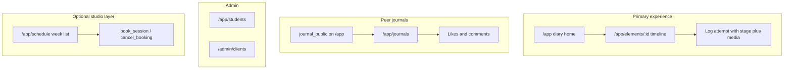

# Pole Progress roadmap

The product is the student's personal training diary for one studio per Supabase project. Diary stages, staff review, admin clients, and public journals are implemented. Remaining diary-home depth comes before optional class admin and a dedicated passes page.

Status values: **DONE** (frontend, data access, and database authorization are present), **PARTIAL** (some of those layers exist), **PLANNED** (not built), **NEEDS VERIFICATION** (the repo cannot prove runtime or remote state).

Work items below keep the identifiers and wording from the previous plan file. A plan-file `pending` mark covers both **PARTIAL** and **PLANNED**; the product status is the prefix inside each item.

| Id | Plan-file status | Item |
| --- | --- | --- |
| `s1-roles` | completed | **DONE:** roles are `admin` and `student` only. The instructor role, `is_staff()`, and `is_instructor()` were removed in `20261012201704_remove_instructor_role.sql`. Admin keeps the former staff checks through `is_admin()` |
| `s2-schema` | completed | **DONE:** class_types/sessions, bookings, pass_products/client_passes migrations, models, APIs, demo seed inside the migration |
| `s3-calendar` | completed | **DONE:** @org/schedule week list, list_sessions_in_range, /app/schedule |
| `booking-optional` | completed | **DONE:** book_session / cancel_booking, capacity UI, pass balances on the schedule page |
| `s4-diary-stages` | completed | **DONE:** attempt stages, chronological media timeline, diary-first shell nav |
| `s5-diary-home` | pending | **PARTIAL:** stage counts, stage pills, search, and with/without-records filter. Still missing a recent-attempts list, a stage filter, and a first-attempt prompt on /app |
| `s6-instructor-diary` | completed | **DONE:** `/app/students` is admin-only. The separate instructor-note box and `attempt_instructor_notes` are removed. Comments stay on `attempt_comments` |
| `public-journals` | completed | **DONE in repo:** journal_public, /app/journals, peer read of attempts and media, likes and comments. Live two-user behavior needs a running stack |
| `admin-clients` | completed | **DONE in repo:** /admin/clients directory, role changes, issue and renew passes. Live admin RPC needs the migration applied |
| `s7-passes-optional` | pending | **PARTIAL:** PassesApi.listMine and balances on /app/schedule. No My Passes page |
| `s8-classes-optional` | pending | **PLANNED:** admin UI for class types and sessions. Tables and staff write RLS exist; Angular has read and booking RPCs only |

## Product focus

The primary value is the **student's personal training diary and progress tracker**. One deployment is one studio and one Supabase project. There is no `studio_id`.

- `/app` is the diary home: element grid, current stage per element, and the public/private journal switch.
- `/app/elements/:id` is the owner's element diary: log an attempt with a stage, then read a chronological photo/video timeline.
- Stages are `trying | in_progress | held | mastered`. The current stage is the **latest attempt by date**, so a later regression replaces an older "mastered".

Schedule, bookings, and passes stay in the codebase. The shell shows **Щоденник** as the primary item. **Розклад** and **Щоденники** are quieter secondary items. **Учні** and **Адмін** are admin-only. New studio-ops work stays behind the remaining diary-home depth.

## Current product features

### Auth, roles, and studio access — DONE

- Routes: `/sign-in`, `/forgot-password`, `/auth/callback`, `/access-pending`, `/forbidden`, and `/app/profile` in [`libs/core/auth/src/lib/auth.routes.ts`](../libs/core/auth/src/lib/auth.routes.ts), [`libs/features/shell/src/lib/shell.routes.ts`](../libs/features/shell/src/lib/shell.routes.ts), and [`apps/app/src/app/app.routes.ts`](../apps/app/src/app/app.routes.ts).
- Email and password, plus Google OAuth, in [`libs/core/auth`](../libs/core/auth). Magic link and Instagram are removed. Google for local Auth is configured in `supabase/config.toml` plus a gitignored `.env` (names in `.env.example`). Password recovery is `/forgot-password`, then `/auth/callback?token_hash&type=recovery`, using [`supabase/templates/recovery.html`](../supabase/templates/recovery.html). `/app/profile` edits `profiles.name`, shows the session email, and sets a password on the current Auth user. Passwords stay in Supabase Auth.
- Roles: `student` (UI: Клієнт) and `admin`. Helpers `is_admin()` and `profile_role_text()`. [`supabase/migrations/20261012201704_remove_instructor_role.sql`](../supabase/migrations/20261012201704_remove_instructor_role.sql) converts every `instructor` profile to `student`, drops `is_instructor()` and `is_staff()`, and rebuilds `user_role` as `admin | student`. A client cannot change `profiles.role`; an admin can, including from `/admin/clients`. Name edits update only `profiles.name`.
- Shell nav in [`libs/features/shell/src/lib/pages/app-shell.page.ts`](../libs/features/shell/src/lib/pages/app-shell.page.ts). **Профіль** is in the header.
- `/admin` and the diary, schedule, journals, and students routes use `studioAccessGuard`. `/app/students` also uses `adminOnlyGuard`. The shell uses `authOnlyGuard`, so `/app/profile` stays open without a pass. An admin enters the diary without a pass. A client needs an active `client_passes` row (`status = 'active'` and now between `valid_from` and `valid_until`). Others land on `/access-pending`. Database rule: `public.has_studio_access()` in [`supabase/migrations/202610080006_studio_access.sql`](../supabase/migrations/202610080006_studio_access.sql), redefined to `is_admin()` or an active pass in `20261012201704`.
- Tests: [`libs/core/auth/src/lib/studio-access.spec.ts`](../libs/core/auth/src/lib/studio-access.spec.ts) covers access rules, sign-up identity classification, OTP types, and auth error copy. [`libs/core/data/src/lib/membership.spec.ts`](../libs/core/data/src/lib/membership.spec.ts) covers membership dates. Playwright covers only the unauthenticated redirect to `/sign-in`.

### Catalog, branding, and the owner's diary — DONE

- Admin: `/admin/categories`, `/admin/elements`, `/admin/branding` behind `adminOnlyGuard`. Catalog images use the public `catalog` bucket.
- Diary home: [`libs/features/dashboard`](../libs/features/dashboard). Stage counts, a stage pill on cards that have attempts, search, category filter, and **Усі / З записами / Без записів**.
- Element timeline: [`libs/features/element`](../libs/features/element). Required stage on create (`Пробую`, `В процесі`, `Утримую`, `Опановано`), defaulting to the element's latest stage. Chronological timeline (oldest first) with forward/back markers. Owner create, edit, and delete. Private `media` bucket; rows store paths and the app mints signed URLs.
- Stage column: [`supabase/migrations/202610080003_attempt_stages.sql`](../supabase/migrations/202610080003_attempt_stages.sql). Models and `listMyProgressRows()` in [`libs/core/data`](../libs/core/data).
- Tests: [`libs/core/data/src/lib/attempt-stage.spec.ts`](../libs/core/data/src/lib/attempt-stage.spec.ts), [`libs/features/element/src/lib/timeline.spec.ts`](../libs/features/element/src/lib/timeline.spec.ts).

### Diary home extras — PARTIAL

Still open from the original session 5, in [`libs/features/dashboard/src/lib/dashboard.store.ts`](../libs/features/dashboard/src/lib/dashboard.store.ts) and [`dashboard.page.ts`](../libs/features/dashboard/src/lib/pages/dashboard.page.ts):

- **PLANNED:** a short recent-attempts list on `/app` across elements.
- **PLANNED:** filter the grid by stage, in addition to with/without records.
- **PLANNED:** an empty prompt that tells a new student to open an element and log the first attempt. The element page already says that when one element has no attempts. The home grid still lists the catalog.

### Admin diary review — DONE

- `/app/students` is behind `adminOnlyGuard` ([`libs/features/students`](../libs/features/students)). A student row opens that client's element grid; an element opens the same timeline. Comments use the shared `attempt_comments` thread. There is no separate note box.
- `StudentsApi.listStudents()` / `getStudent()`, `AttemptsApi.listProgressRows()` / `listAttemptsForElement()`.
- [`supabase/migrations/202610080005_staff_read_student_diary.sql`](../supabase/migrations/202610080005_staff_read_student_diary.sql) added select on attempts, media rows, and the private media bucket. `20261012201704` limits those policies to `is_admin()`.
- `attempt_instructor_notes` was added in [`supabase/migrations/202610080004_attempt_instructor_notes.sql`](../supabase/migrations/202610080004_attempt_instructor_notes.sql) and dropped in `20261012201704`. Existing note rows are deleted and are not copied into comments.

### Public journals — DONE in the repository

- Default is private. The owner turns on **Публічний щоденник** on `/app` ([`journal-visibility.component.ts`](../libs/features/dashboard/src/lib/components/journal-visibility.component.ts)).
- Peers with studio access open `/app/journals`, then the same diary grid and element timeline with `data.diary = 'journal'`. Turning the journal private hides attempts and media again. An admin still reads every diary at `/app/students`.
- Likes and comments: `attempt_likes`, `attempt_comments`, [`JournalsApi`](../libs/core/data/src/lib/journals.api.ts), [`attempt-reactions.component.ts`](../libs/features/element/src/lib/components/attempt-reactions.component.ts). A peer can like or comment only on someone else's public journal. The owner can delete comments on their attempts. Comment text is trimmed and limited to 2000 characters in both the client helper and the check constraint.
- Security: [`supabase/migrations/202610090002_public_journals.sql`](../supabase/migrations/202610090002_public_journals.sql). `journal_public` on `profiles`. Peer select policies for profiles, attempts, media rows, and `storage.objects`. Helpers live in schema `private`, which is not in the exposed API schemas (`supabase/config.toml` exposes `public` and `graphql_public`).
- Tests: [`libs/core/data/src/lib/journal.spec.ts`](../libs/core/data/src/lib/journal.spec.ts), [`attempt-reactions.component.spec.ts`](../libs/features/element/src/lib/components/attempt-reactions.component.spec.ts). These cover the visibility helpers, not Postgres or Storage.

### Admin clients — DONE in the repository

- `/admin/clients` ([`libs/features/admin/src/lib/pages/clients.page.ts`](../libs/features/admin/src/lib/pages/clients.page.ts)): name, email, id, role, and whether a pass is active now. Search. **Видати** inserts an active `client_passes` row. **Продовжити** updates that active row and refills `remaining` from the chosen product. Role changes call `ProfilesApi.updateRole()`. The signed-in admin cannot change their own role in the UI.
- Emails come from `admin_profile_emails()` in [`supabase/migrations/202610090001_admin_clients.sql`](../supabase/migrations/202610090001_admin_clients.sql). Insert and update on `client_passes` require `is_admin()`. If the RPC is missing, the page still lists profiles and shows ids.
- Pass products are read from `pass_products`. The page tells the admin when that catalog is empty. There is no product editor.
- Tests: [`client-directory.spec.ts`](../libs/features/admin/src/lib/client-directory.spec.ts), [`pass-dates.spec.ts`](../libs/features/admin/src/lib/pass-dates.spec.ts).

### Schedule, booking, and passes — DONE as the secondary area; two UI pieces remain

- `/app/schedule`: week list, type filter, book and cancel, capacity, pass balances. [`libs/features/schedule`](../libs/features/schedule), [`ScheduleApi`](../libs/core/data/src/lib/schedule.api.ts), [`BookingsApi`](../libs/core/data/src/lib/bookings.api.ts). Mutations stay on `book_session` and `cancel_booking` ([`supabase/migrations/202610080002_booking_rpcs.sql`](../supabase/migrations/202610080002_booking_rpcs.sql), redefined with the studio-access check in `202610080006`).
- Schema and admin write policies for `class_types`, `class_sessions`, `pass_products`, `client_passes`, and `bookings`: [`supabase/migrations/202610080001_schedule_bookings_passes.sql`](../supabase/migrations/202610080001_schedule_bookings_passes.sql), with `is_staff()` replaced by `is_admin()` in `20261012201704`. `class_sessions.instructor_id` remains the class teacher, not a role.
- **PARTIAL — My Passes:** `PassesApi.listMine()` and the balance list on the schedule page. No `/app/passes` route and no `@org/passes` library.
- **PLANNED — class admin:** no Angular screens or write methods for class types or sessions. Creating or editing the weekly schedule is SQL or Studio today. The migration also inserts demo class types, one week of sessions, one pass product, and two demo auth users (`instructor.demo@pole.local`, `client.demo@pole.local`). `20261012201704` sets the demo teacher's role to `student` and keeps that profile because sessions reference it. The email stays. The SQL comment says local only; the statements are not wrapped in an environment check.
- Test: [`libs/features/schedule/src/lib/week.spec.ts`](../libs/features/schedule/src/lib/week.spec.ts) for Kyiv week math.

## Current priorities

1. Finish the diary home (recent attempts, stage filter, first-attempt prompt). This is the next product change.
2. Confirm the public-journal and admin-client flows on a database that has `202610090001` and `202610090002`. That is a verification step for work already in the repo.
3. Optional, after the diary home: a class-admin screen, then a My Passes page if the studio still wants that nav item. Pass-product editing is the same optional studio area; issuing a pass already works when a product row exists.

## Schema and migration inventory

Migrations in `supabase/migrations/`, in apply order:

| Migration | What it adds |
| --- | --- |
| `202601240001_init.sql` | `profiles`, `app_settings`, `element_categories`, `elements`, `element_attempts`, `media`; `user_role` (`admin`, `student`), `media_type`; `handle_new_user()` |
| `202601240002_rls.sql` | RLS and `is_admin()` |
| `202601240003_storage_policies.sql` | Owner policies on the `media` bucket |
| `202601240004_storage_bucket.sql` | Private `media` bucket |
| `202601240005_storage_limits.sql` | 100 MB, image and video allowlist |
| `202601240006_grants.sql` | Grants for the diary tables |
| `202601240007_catalog_bucket.sql` | Public-read, admin-write `catalog` bucket |
| `202610070001_roles_instructor.sql` | Historical: added `instructor`, `is_staff()`, role-change protection. Removed by `20261012201704` |
| `202610080001_schedule_bookings_passes.sql` | `class_types`, `class_sessions`, `pass_products`, `client_passes`, `bookings`; demo users, sessions, and one pass |
| `202610080002_booking_rpcs.sql` | `list_sessions_in_range`, `get_session_card`, `book_session`, `cancel_booking` |
| `202610080003_attempt_stages.sql` | `attempt_stage`, `element_attempts.stage` |
| `202610080004_attempt_instructor_notes.sql` | Historical: `attempt_instructor_notes`. Dropped by `20261012201704` |
| `202610080005_staff_read_student_diary.sql` | Admin read of attempts, media rows, and media objects. Policies now use `is_admin()` |
| `202610080006_studio_access.sql` | `has_studio_access()`; diary and schedule policies require it |
| `202610090001_admin_clients.sql` | `client_passes` insert/update become `is_admin()`; `admin_profile_emails()` |
| `202610090002_public_journals.sql` | `profiles.journal_public`, peer read policies, `attempt_likes`, `attempt_comments`, `private` helpers |
| `20261012201704_remove_instructor_role.sql` | Drops the instructor role and `attempt_instructor_notes`. Former `is_staff()` checks become `is_admin()`. Applied migration files still contain the old words |

Storage: `media` is private (`user/{uid}/attempt/{attemptId}/...`). `catalog` is public read. The database stores paths.

## Architectural constraints

- Angular 21 standalone components, signals, `OnPush`, Tailwind. Ukrainian UI copy.
- Nx libraries: `@org/supabase`, `@org/auth`, `@org/data`, `@org/shell`, `@org/dashboard`, `@org/element`, `@org/schedule`, `@org/students`, `@org/admin`. `@org/data` does not import `@org/auth`. Supabase I/O stays in `@org/data` except auth-specific calls.
- Booking changes go through the RPCs. Do not reimplement capacity or pass spending in Angular.
- Angular guards and hidden nav items are not the security boundary. RLS and the RPCs are.
- Authorization reads `profiles.role` through security-definer helpers. It does not trust client-supplied role or user id.
- Journal visibility helpers are in `private` so PostgREST does not expose them. `public.has_studio_access`, the booking RPCs, `is_admin`, and `admin_profile_emails` are security definer in the exposed `public` schema; execute is granted to `authenticated` and the function bodies enforce the check.
- Do not edit a migration that has already been applied. Add a new file.
- Keep one studio per project. Do not add `studio_id`.

## Release workflow

Local app and database:

1. `npm i`
2. `supabase start` (Studio `http://127.0.0.1:54323`, Mailpit `http://127.0.0.1:54324`, API `http://127.0.0.1:54321`). Local `[analytics]` stays off: Colima's sshfs mount cannot pass the Docker socket to Vector, and that unhealthy container stops the stack.
3. `npx nx serve app` → `http://localhost:4200`
4. The Angular app reads `apps/app/src/environments/environment.development.ts`. It does not load `.env`. `.env` is for the Supabase CLI (Google client id and secret).

Validate a new migration locally before any remote apply:

1. Add a new file under `supabase/migrations/`. Leave applied files unchanged.
2. Keep local data with `supabase migration up`. Use `supabase db reset` only when discarding the local database is acceptable. That command reapplies every migration, including the demo users inside `202610080001`.
3. Do not run `supabase db reset` or data-rewriting SQL against a remote project as part of normal work.

GitHub and the static frontend:

1. `git push` publishes the branch. Vercel deploys only if that project's Git integration is already pointed at this repo. This repository has no `vercel.json`.
2. CI ([`.github/workflows/ci.yml`](../.github/workflows/ci.yml)) runs on pull requests and `main`: `npx nx run-many -t lint test build typecheck e2e`.
3. Production client config is build-time in `apps/app/src/environments/environment.ts` (hosted Supabase URL and publishable key). `npx nx build app` writes `dist/apps/app/`. The host must serve the SPA with a fallback to `index.html`.
4. In the hosted Supabase project, set **Authentication → URL Configuration** so Google and password recovery return to `${origin}/auth/callback`. Enable Google there separately from local `config.toml`. Copy [`supabase/templates/recovery.html`](../supabase/templates/recovery.html) into the hosted Recovery template (`token_hash`, `type=recovery`). Leave the Email provider enabled. Magic link and Instagram are not offered.

Production database:

1. Inspect the linked project and the pending list first.
2. `supabase link --project-ref <ref>`
3. `supabase db push --dry-run`, then `supabase db push` when the plan is the one you reviewed.
4. `db push` does not deploy the Angular app. A frontend deploy does not apply migrations.
5. The first admin is still a SQL update of `profiles.role` after that person has signed in once. Later role and pass changes belong in `/admin/clients`.

## Needs verification

These are implemented in SQL and TypeScript and are not proven by an automated database or browser test:

- A second client with an active pass can open a public journal, see photos and videos through signed URLs, like, comment, edit their comment, and lose that read when the owner turns the journal private.
- The owner and an admin still see existing likes and comments after the journal goes private. A peer cannot.
- Issuing or renewing a pass on `/admin/clients` is what lets that client pass `studioAccessGuard`.
- `book_session` spends one class and `cancel_booking` restores it only when the RPC says so.
- The hosted project needs `20261012201704` before the app that no longer sends `instructor` can change roles. If `202610080001` has not been applied, the next `db push` still creates the demo class teacher, demo client, pass, and a week of sessions, then `20261012201704` sets that teacher's role to `student`.
- The hosted Google provider, redirect URLs, and Recovery email template match the production origin. The repo only configures the local CLI path. Hosted email confirmation may still be on; the app treats an empty `identities` list on sign-up as an existing account.
- Password recovery and setting a password on a Google-only user. The flow is in the app and the local recovery template; hosted SMTP and the dashboard template were not changed.
- Saving a name on `/app/profile` is allowed by the existing own-row update policy and is not covered by an RLS test.

## Technical debt

Separate from product scope:

- Several store error fallbacks are English: "Failed to load dashboard", "Failed to load element", "Failed to load student diary", "Failed to load students". Visible UI copy is otherwise Ukrainian.
- `client_passes` INSERT, UPDATE, and DELETE are admin-only. No screen calls that delete.
- `202610080001` inserts demo auth users with password `demo-local-only` on every database that applies it.
- Automated tests are unit tests of helpers and a few components, plus one Playwright redirect. There is no RLS or Supabase integration suite.
- [`readme.md`](../readme.md) describes journals, studio access, and `/admin/clients`. Its project tree omits `@org/students`.

## Explicitly out of scope

Payments, multi-studio or `studio_id`, waitlists, mobile native, email or SMS reminders, Analog file-based routing, additional auth providers, account merging, and deleting the schedule and booking module.
